# AI video editing skills

**41 free video edits for your AI agent.** Film yourself talking, drop the video into Claude
Code or Codex, and say what you want. It cuts the pauses, captions every word, puts a giant word
behind your head, drops in your B-roll, grades the colour and lays your music under your voice.
No editing app, no account, nothing to pay. It all runs on your own computer, so your video is
never uploaded.

<p align="center">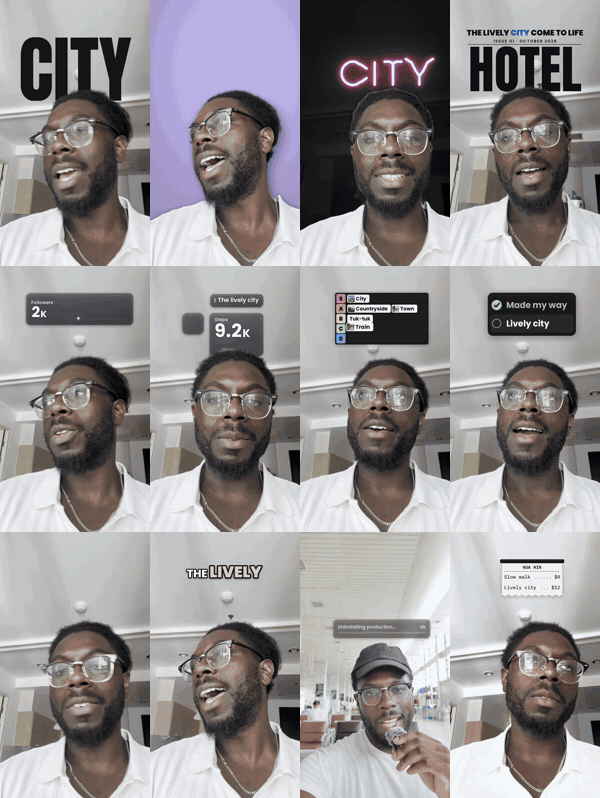</p>

<!-- This page is written by tools/build_manifest.py from effects/*/effect.json. Edit those, not this. -->

## Start in one paste

Open Claude Code (the desktop app or the terminal), paste this, and drop your video in after it:

```
Install the free video editing skills from github.com/AskEditor/ai-video-editing-skills into ~/.claude/skills/video-editing, then clean cut my video:
```

Claude installs the skills and makes the edit. After that first time, just ask:

<p align="center">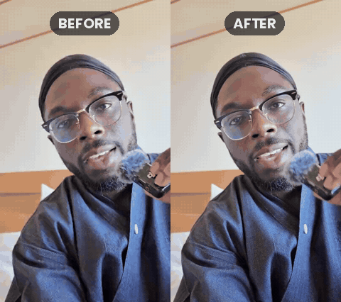</p>

| You say | You get |
|---|---|
| "cut the pauses and retakes" | the dead air and false starts gone, captions on |
| "put a giant word behind me when I say city" | the word behind your head, landing as you say it |
| "turn the lights down, with my name in neon" | the room goes dark and you stay lit |
| "cut my b-roll in when I mention each place" | your own footage on the words that name it |
| "add a tier list as I rank these" | each card drops into its row the moment you rank it |
| "lay my song under this" | the music dips while you talk and ends with the video |

You never need to know a command: say it the way you would say it to an editor, with the timing
in plain words ("when I say 'watch'"). Claude finds the exact second. If you like commands, every
effect also has one, `/video-editing <effect> <video>`, listed in its own page.

### Or install it yourself

For Claude Code:

```
git clone https://github.com/AskEditor/ai-video-editing-skills ~/.claude/skills/video-editing
```

For Codex (the ChatGPT desktop app's agent):

```
git clone https://github.com/AskEditor/ai-video-editing-skills ~/.codex/skills/video-editing
```

Then start a new chat. The first edit sets itself up in its own folder, a few minutes and about
600 MB of free tools and models. It needs ffmpeg and Python 3.10, 3.11 or 3.12, and says exactly
how to get either if one is missing. Tested on macOS; Linux and Windows are untested so far.

## What it does well

- **It listens.** A free speech model on your computer hears every word and when it is said, so
  captions, titles and graphics land on the word. It skips the word you took back ("the town, or
  the city": it uses *city*) and the talk about the recording ("give me a second").
- **It keeps your face clear.** Words, cards and graphics stay off your face and inside the part of
  the screen Reels, Shorts and TikTok never cover. Some effects put things behind you instead.
- **It checks before it renders.** Every effect shows Claude a few frames first, so a problem is
  caught before the whole video is made. `qc-check` checks the finished file too.
- **Your sound is looked after.** Your voice is kept, and sounds and music sit under it at the
  loudness the apps use.

## All 41 effects

### Cut and clean up

| | Effect | Just say |
|---|---|---|
| 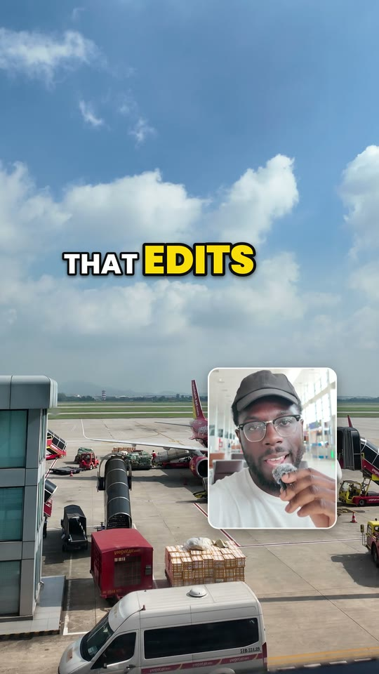 | [**B-roll cutaways**](effects/broll-cutaways/README.md)<br>Your footage cut in on the words | “add my b-roll” |
|  | [**Transitions**](effects/transitions/README.md)<br>A whip, wipe or flash between two shots | “add transitions” |
|  | [**Long video to shorts**](effects/long-to-shorts/README.md)<br>One long talk cut into vertical clips | “turn this into shorts” |
|  | [**Clean cut**](effects/clean-cut/README.md)<br>Pauses and retakes out, captions on | “cut the pauses” |

### Words on screen

| | Effect | Just say |
|---|---|---|
|  | [**Captions**](effects/captions/README.md)<br>Every word on screen, clear of your face | “add captions” |
|  | [**Headline**](effects/headline/README.md)<br>Big type on the line that makes a point | “add a headline” |

### Behind you

| | Effect | Just say |
|---|---|---|
|  | [**New backdrop**](effects/backdrop/README.md)<br>Cut out of your room, set somewhere new | “replace my background” |
| 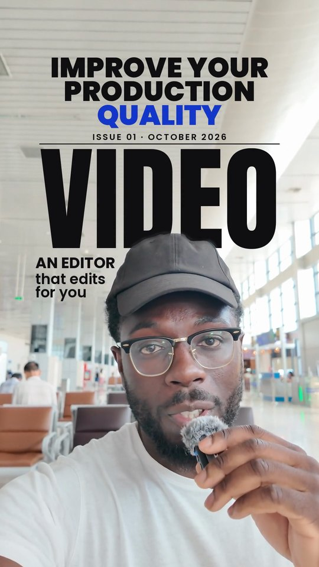 | [**Magazine cover**](effects/magazine-cover/README.md)<br>You on a cover, its name behind you | “make me a magazine cover” |
|  | [**Pictures behind you**](effects/pictures-behind/README.md)<br>A wall of your screenshots behind you | “pile my reels up behind me” |
|  | [**Spotlight**](effects/spotlight/README.md)<br>The room goes dark and you stay lit | “turn the lights down” |
|  | [**Words behind you**](effects/words-behind/README.md)<br>A giant word behind your head | “put a word behind me” |

### Graphics over the picture

| | Effect | Just say |
|---|---|---|
|  | [**Chapter cards**](effects/chapter-cards/README.md)<br>Your talk in parts, each with a title | “add chapters” |
| 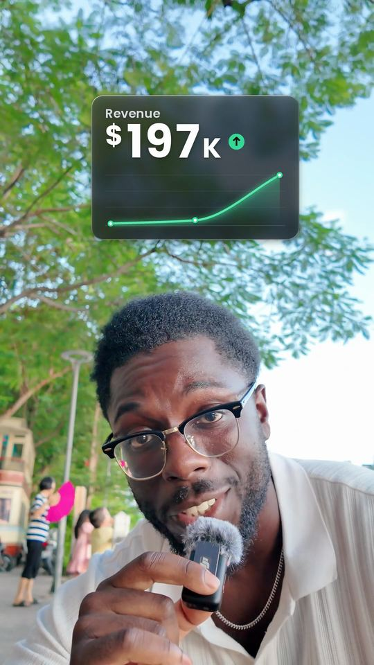 | [**Chart**](effects/chart/README.md)<br>A line climbs as the number lands | “add a chart” |
| 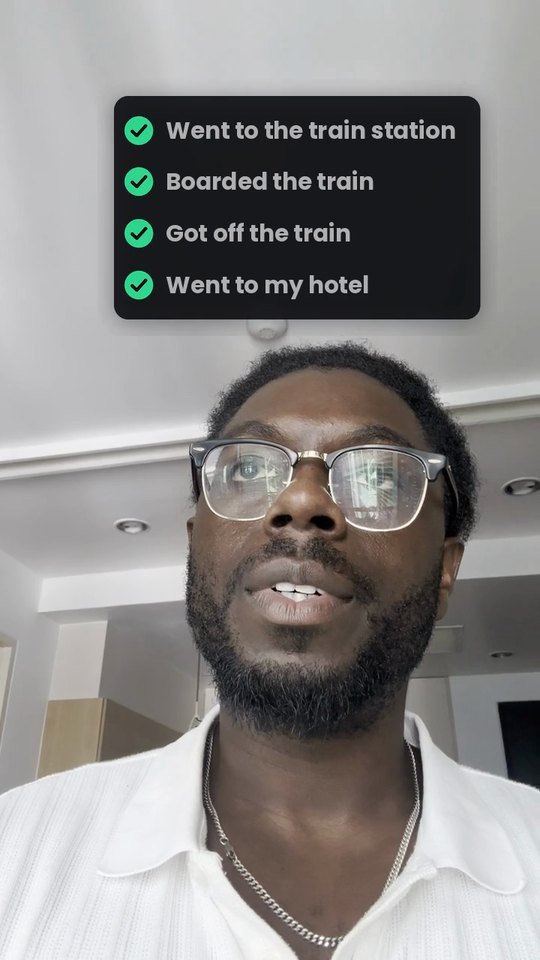 | [**Checklist**](effects/checklist/README.md)<br>Steps tick off as you say them | “add a checklist” |
| 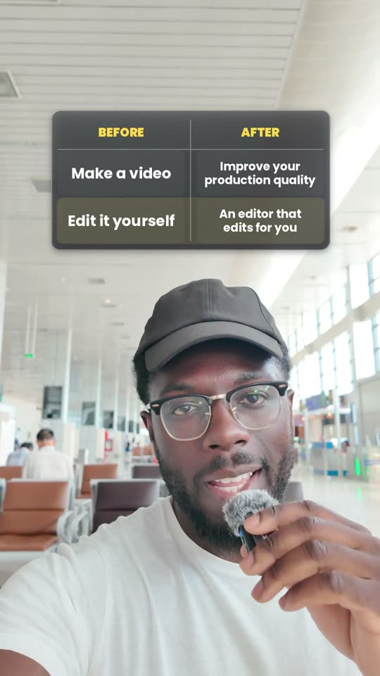 | [**This versus that**](effects/comparison-grid/README.md)<br>Two columns that fill as you compare | “compare these two” |
|  | [**Call to action**](effects/cta-card/README.md)<br>Ends asking people to comment or follow | “add a call to action” |
|  | [**Freeze and point**](effects/freeze-point/README.md)<br>It freezes, and an arrow points at you | “freeze the frame and point at me” |
| 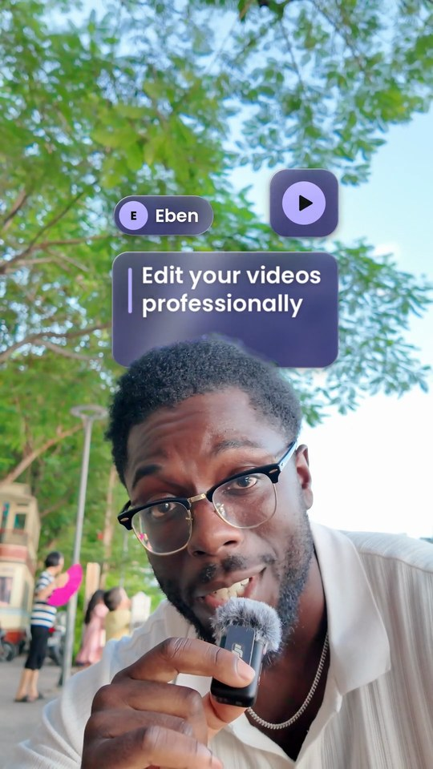 | [**Glass widgets**](effects/glass-widgets/README.md)<br>Glass cards with your numbers round you | “add glass widgets” |
| 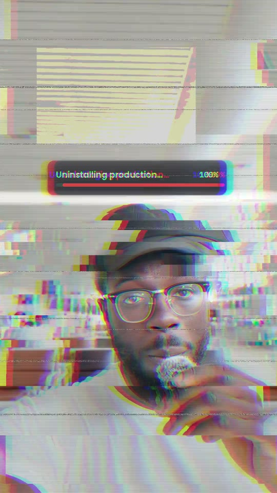 | [**Glitch**](effects/glitch/README.md)<br>The frame breaks apart on a word | “add a glitch” |
|  | [**Hook**](effects/hook/README.md)<br>An opener built on your first line | “add a hook” |
| 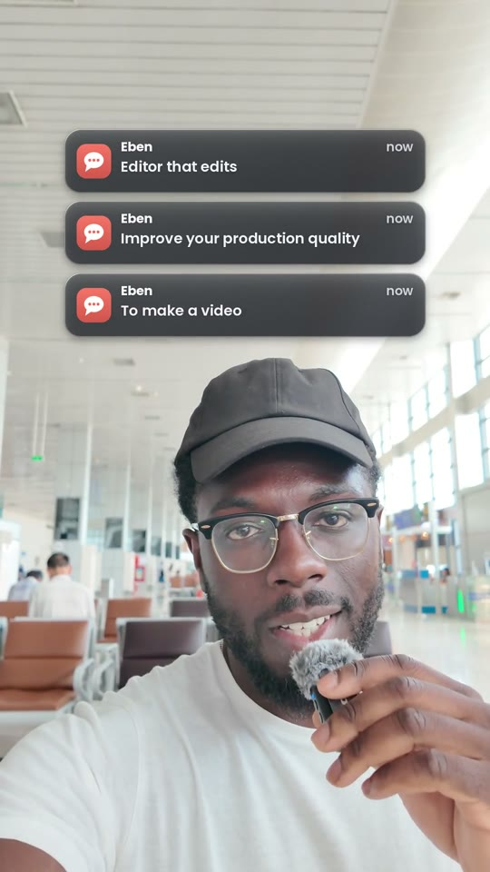 | [**Notifications**](effects/notifications/README.md)<br>Messages pop in as you speak | “add notifications” |
|  | [**Number counter**](effects/number-counter/README.md)<br>Every number you say counts up on screen | “count up the numbers I say” |
|  | [**Pictures above your head**](effects/pictures-above-head/README.md)<br>Your proof pops in as you name it | “put pictures above my head” |
| 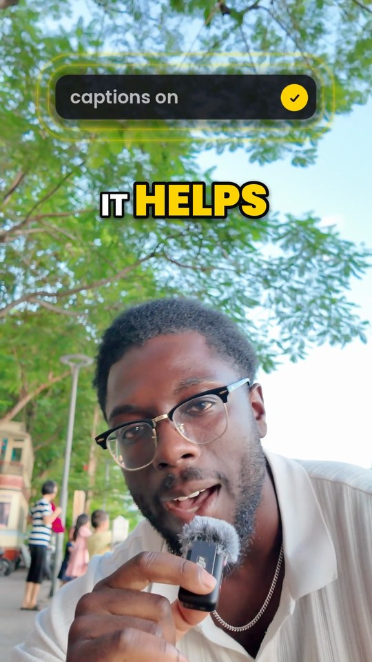 | [**Prompt box**](effects/prompt-box/README.md)<br>A prompt types, and the edit answers | “type the prompt on screen” |
| 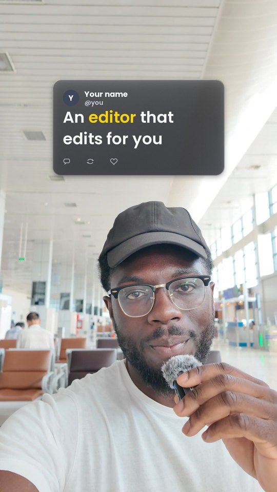 | [**Quote card**](effects/quote-card/README.md)<br>A quote lit word by word as you read it | “show the quote as a card” |
| 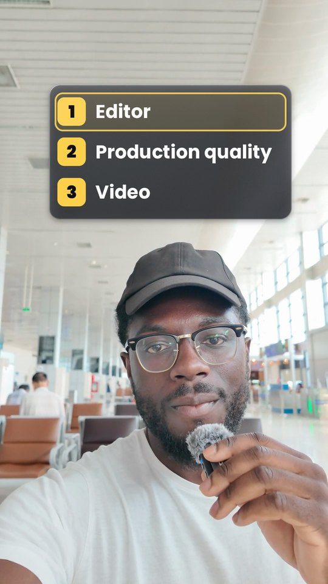 | [**Ranked list**](effects/ranked-list/README.md)<br>Your top five pops in as you say it | “make a top 5 list” |
|  | [**Receipt**](effects/receipt/README.md)<br>Your list prints out, prices and total | “print my list like a receipt” |
|  | [**Retro overlay**](effects/retro-overlay/README.md)<br>A camcorder, tape or old film look | “make it look like a camcorder” |
| 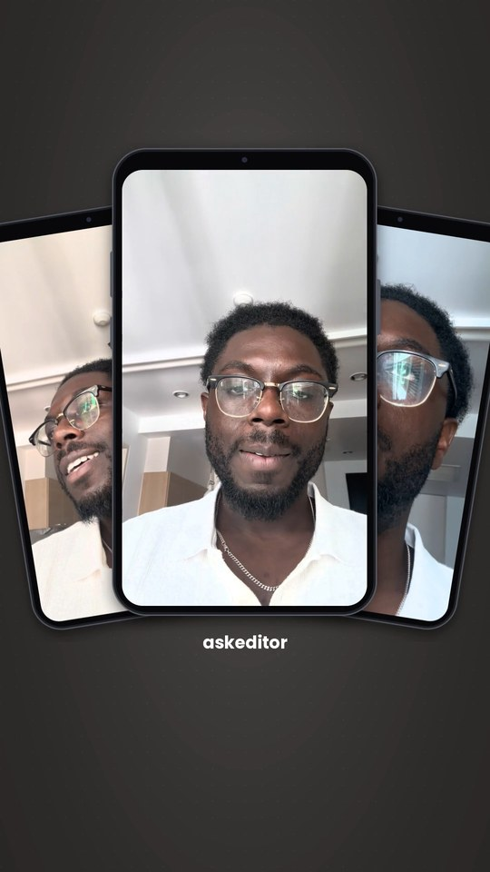 | [**Social frame**](effects/social-frame/README.md)<br>Your clip shrinks into a phone and plays | “put my video in a phone” |
|  | [**Stickers**](effects/stickers/README.md)<br>A price tag or stamp slaps on the word | “add stickers” |
|  | [**Tier list**](effects/tier-list/README.md)<br>Rank things into rows as you speak | “make a tier list” |

### Camera and layout

| | Effect | Just say |
|---|---|---|
|  | [**Punch-in**](effects/punch-in/README.md)<br>A quick zoom on the word that matters | “punch in on the point” |
| 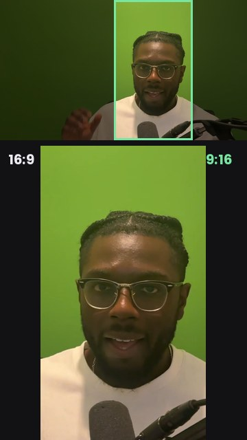 | [**Reframe**](effects/reframe/README.md)<br>Landscape made vertical, face kept in | “make this vertical” |
| 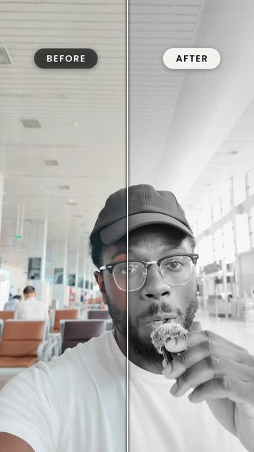 | [**Before and after**](effects/before-after/README.md)<br>Your clip as shot, wiped into your edit | “show a before and after” |
|  | [**Split layout**](effects/split-layout/README.md)<br>You and your B-roll sharing the frame | “put me in a panel at the bottom with my b-roll on top” |

### Colour and sound

| | Effect | Just say |
|---|---|---|
| 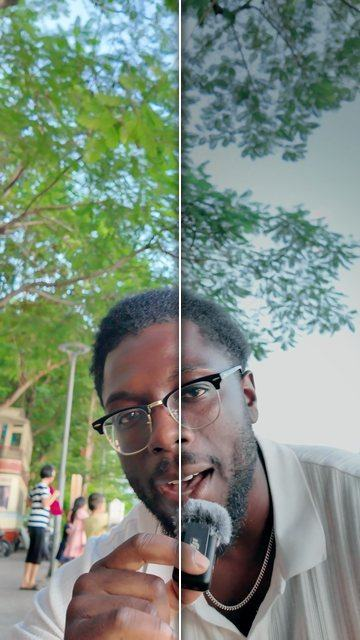 | [**Colour grade**](effects/grade/README.md)<br>One-word colour look, skin kept natural | “make it moody” |
| 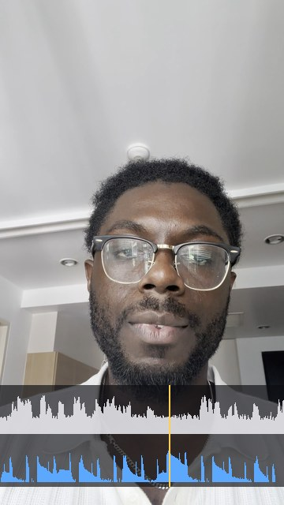 | [**Music bed**](effects/music-bed/README.md)<br>Your song dips while you talk | “add my music under this” |
|  | [**Sound effects**](effects/sound-effects/README.md)<br>Whooshes and pops on every cut | “add sound effects” |

### Checks and publishing

| | Effect | Just say |
|---|---|---|
| 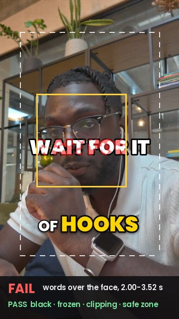 | [**Checks before done**](effects/qc-check/README.md)<br>Finds faults before you post | “check this before I post it” |
| 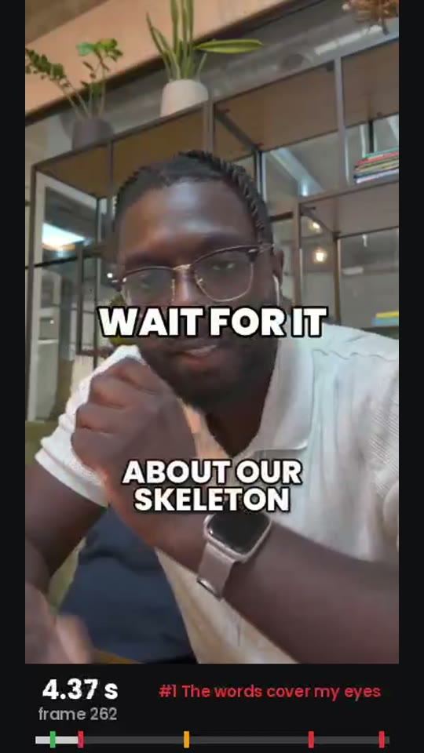 | [**Review notes**](effects/review-notes/README.md)<br>Notes at exact seconds, each one fixed | “let me review it first” |
| 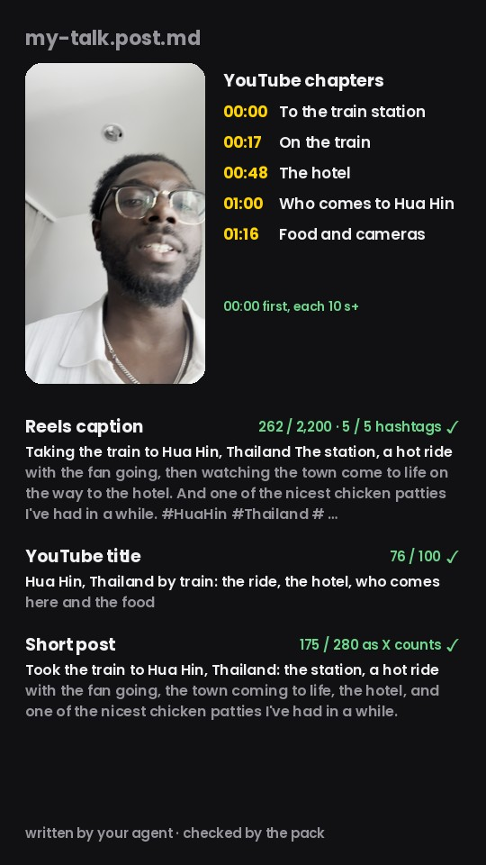 | [**Post copy**](effects/post-copy/README.md)<br>Titles, captions and hashtags to post | “write my caption” |

## What it does not do

- It edits videos of someone talking, in English, with one person in the picture at a time.
- It draws one thing over the picture per video. Run effects one after another: cuts first, then
  colour or anything behind you, then one effect over the picture, then sound.
- It makes no new pictures, voices or music. The music it lays is yours.
- Every result is a finished MP4. Changing it means asking again and rendering again.

## Want to change it without rendering again?

[AskEditor](https://askeditor.com) keeps the same edit open on a canvas: move a caption, retype a
word, swap a picture, with no new prompt and no new render. It also makes what this pack leaves
out: voices, music, generated scenes, and ready-made templates. See the
[templates in AskEditor](https://askeditor.com/templates).

## Licence

The code is MIT licensed. The fonts are under the SIL Open Font License, and the models each keep
their own licence; [NOTICE.md](NOTICE.md) lists them all.
